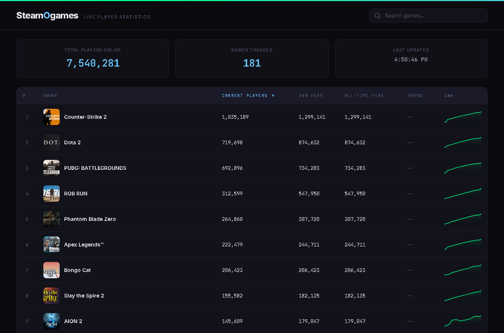

# SteamOgames

Live Steam game player statistics — track concurrent players, peaks, and trends with a modern dark-themed dashboard.



## Features

- **Top 100 most played** Steam games with live concurrent player counts, taken from Steam's own live chart, so new releases show up without touching the code
- **24-hour peak** and **all-time peak** player tracking
- **Player trend** percentage (up/down vs yesterday)
- **Sparkline charts** showing 24h player trends per game
- **Game detail modal** with interactive Chart.js player history (24h / 7d / 30d)
- **Instant search** filtering with API-backed results
- **Auto-refresh** every 5 minutes
- **Honest status**: "Last Updated" is the time of the newest data, and a banner appears when a refresh fails, the data is stale, or Steam cut a scrape short
- Dark theme with glassmorphism effects

## Tech Stack

- **Backend**: Python / Flask
- **Frontend**: Vanilla HTML / CSS / JS
- **Charts**: Chart.js
- **Database**: SQLite (auto-created)
- **Scheduler**: APScheduler

## Setup

No Steam API key is needed: every endpoint used is keyless.

With [uv](https://docs.astral.sh/uv/) (recommended; `uv.lock` pins every dependency):

```bash
git clone https://github.com/0xmortuex/steamogames.git
cd steamogames

uv run python app.py
```

With pip:

```bash
python -m venv .venv
source .venv/bin/activate  # Windows: .venv\Scripts\activate
pip install -r requirements.txt

python app.py
```

Open [http://localhost:5000](http://localhost:5000) in your browser.

The scraper runs automatically on startup and refreshes every 5 minutes. On the very first start the top 100 appear within a second or two, but as "App 730"-style placeholders: names and artwork are looked up one game at a time (most played first, one request every 1.5 seconds). The 100 games on screen have their names after about three and a half minutes, and the page refreshes itself every 20 seconds while that is going on. Tracked games further down (reachable through search) get theirs in the next cycle.

### Standalone scraper

You can also run the scraper on its own, without the dashboard:

```bash
uv run python scraper.py
```

`app.py` starts its own scraper too. To run both as separate processes, start the dashboard with `SCRAPER_ENABLED=0` so the games are not scraped twice.

### Tests

```bash
uv run pytest
```

The tests use a temporary database and never contact Steam.

## Where the data comes from

Each 5-minute cycle makes about 80 requests to Steam:

| Request | Endpoint | Used for |
|---------|----------|----------|
| 1 per cycle | `ISteamChartsService/GetGamesByConcurrentPlayers` | Steam's live top 100: current players and the day's peak for each game |
| 1 per remaining tracked game (~80) | `ISteamUserStats/GetNumberOfCurrentPlayers` | Current players of tracked games outside the top 100 |
| 1 per new game | `store.steampowered.com/api/appdetails` | Name and artwork, fetched once per game |

Which games are tracked:

- everything in Steam's live top 100, plus
- the fixed list `TRACKED_APPIDS` in `scraper.py`, which is always tracked, plus
- games that were in the top 100 during the last 7 days, so a game hovering around rank 100 keeps a continuous history.

The chart endpoint is the one behind [store.steampowered.com/charts/mostplayed](https://store.steampowered.com/charts/mostplayed). It needs no key but is not part of Steam's documented Web API. If it cannot be read, the dashboard says so and keeps updating the games it already tracks one request at a time.

If Steam answers HTTP 429 (rate limit) or stops responding, the scraper ends that pass instead of retrying, reports it in the dashboard, and tries again at the next cycle.

## What the numbers mean

| Number | Meaning |
|--------|---------|
| Current Players | The game's newest sample (at most 15 minutes older than the newest sample overall; games without one are not listed) |
| 24h Peak | The highest of our own samples from the last 24 hours, or Steam's reported peak for the day when that is higher |
| All-Time Peak | The highest count recorded **since this dashboard started tracking the game**. Steam offers no all-time figure, so it is not the game's historical record |
| Trend | Current players compared with the average of 20 to 28 hours ago; empty until a day of history exists |
| Total Players Online | Sum of the current players of all tracked games (not everyone on Steam) |
| Games Tracked | Games that currently have a count |
| Last Updated | Time of the newest sample, in your local time |

## API Endpoints

| Method | Path | Description |
|--------|------|-------------|
| `GET` | `/` | Main dashboard page |
| `GET` | `/api/top?limit=100` | Top games with current players, peaks, trends, sparklines (`limit` 1 to 200) |
| `GET` | `/api/game/<appid>?hours=24` | Game detail + player count history (`hours` 1 to 720) |
| `GET` | `/api/search?q=term` | Search tracked games by name (at least 2 characters) |

Timestamps are UTC in ISO 8601 without an offset, e.g. `2026-11-16T11:43:31.446602`.

### Example response: `/api/top`

```json
{
  "games": [
    {
      "appid": 730,
      "name": "Counter-Strike 2",
      "thumbnail_url": "https://.../capsule_231x87.jpg",
      "header_image_url": "https://.../header.jpg",
      "current_players": 1200000,
      "peak_24h": 1400000,
      "all_time_peak": 1800000,
      "timestamp": "2026-11-16T11:43:31.446602",
      "trend": 5.2,
      "sparkline": [1100000, 1150000, ...]
    }
  ],
  "total_players": 30000000,
  "tracked_count": 180,
  "updated_at": "2026-11-16T11:43:31.446602",
  "server_time": "2026-11-16T11:45:02.118340",
  "scraper": {
    "enabled": true,
    "running": false,
    "last_started": "2026-11-16T11:43:31.444044",
    "last_finished": "2026-11-16T11:44:05.971793",
    "games_ok": 180,
    "games_failed": 0,
    "error": null
  }
}
```

`updated_at` is when the data was last refreshed, `scraper.error` is a sentence describing what cut the last scrape cycle short (or `null`), and `games_failed` counts tracked games that got no new sample in it.

`/api/game/<appid>` returns `{"game": {...}, "history": [{"current_players": 1200000, "timestamp": "..."}]}`. `game.current_players` is the game's newest sample and `game.updated_at` its time; both are `null` for a game that has never been sampled. An unknown app id gives `404` with `{"error": "Game not found"}`.

## Configuration

Settings are environment variables. The app does not read a `.env` file by itself; either set them in your shell or copy `.env.example` to `.env` and start with `uv run --env-file .env python app.py`.

| Variable | Description | Default |
|----------|-------------|---------|
| `PORT` | Server port | `5000` |
| `SCRAPER_ENABLED` | Set to `0` to serve the dashboard without scraping | `1` |
| `HISTORY_DAYS` | Delete samples older than this many days, once a day (minimum 30) | unset: keep everything |

The database is `data/steam.db`, created on first start. It grows by roughly 4.5 MB per day at ~180 tracked games (about 1.6 GB per year) unless `HISTORY_DAYS` is set. Peaks are stored separately and survive the cleanup. An invalid `HISTORY_DAYS` stops the app at startup rather than risking history you meant to keep.

## License

MIT
